# Melamu Holdings OS

**A business operating system for a trading business: trading operations, money, capital allocation, continuity and planning in one place.**

 

> **This is a showcase.** The application's source code is in a private repository. You can read what it does and how it is built here; [the code is available on request](#code-on-request).
>
> Every screenshot comes from a **fictional demo database**. The names, accounts and amounts are invented, and the app says so on every page.

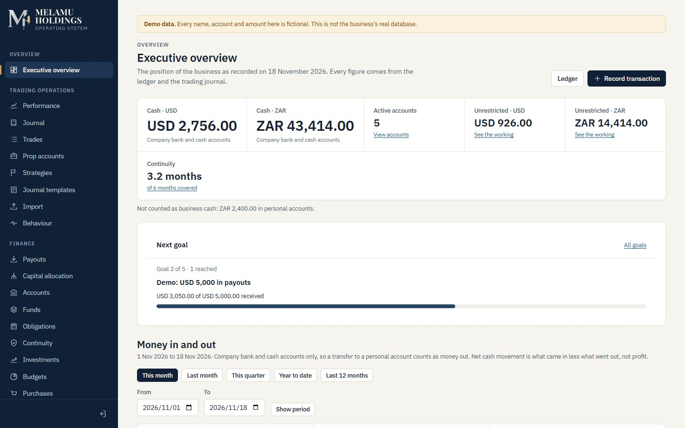

## The problem it solves

A trading business earns in bursts: prop firm payouts arrive in US dollars on no fixed schedule, while rent, subscriptions and personal needs are paid in rand every month. Spreadsheets mix up money that was *requested* with money that *arrived*, and trading profit with cash, and business money with personal money.

Melamu Holdings OS keeps those apart. It records only what actually happened, and it splits every payout by a written allocation policy:
- 40% to Operating Capital;
- 30% to Business Continuity;
- 20% to the Wealth Fund;
- 10% to the Owner's Distribution.

From those records it shows where the business stands.

It started as a trading performance dashboard and was evolved in ten phases into the operating system, without losing the trading features.

## What it does

### Executive overview

- **Business cash per currency.** Currencies are never added together, and personal accounts are shown apart, not counted.
- **Unrestricted cash:** what is free to use after minimums, commitments and money still owed to funds.
- **Money in and out for any period,** with every figure linking to the ledger lines behind it.
- **Fund positions, the next goal, and a "needs attention" list.** The list is derived from the records: unallocated money, funds below their minimum, bills due, continuity below target, prop accounts near a limit.

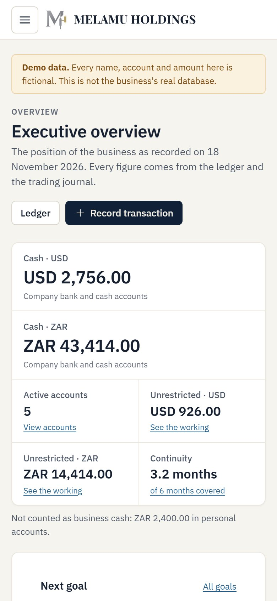

### Payouts and capital allocation

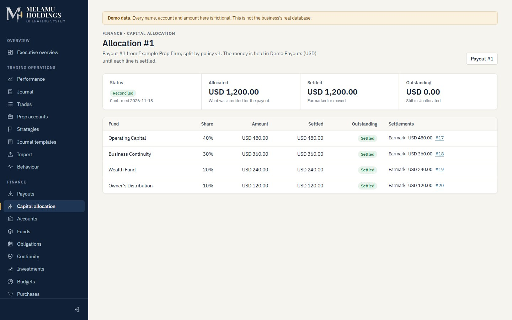

- **A payout moves Requested → Approved → Received.** A request is never cash. Only a receipt reaches the ledger, with any fee deducted on the way kept visible.
- **Versioned allocation policies.** Version 1 is 40/30/20/10. A new version never changes past allocations.
- **Allocate the payout:**
  - Preview the split to the cent, with leftover cents going to the largest remainders so the lines always add up.
  - Confirm it once.
  - Settle each line by earmarking, transferring or exchanging into another currency.
- **Status follows the settlements:** Confirmed → Partially settled → Reconciled.

### Financial management

- **Accounts:** bank, cash and brokerage accounts, each in one currency with stated ownership (company or personal). The only reference stored is at most the last four digits.
- **An append-only ledger:**
  - Income, expenses, transfers, earmarks between funds, currency exchanges at the rate actually received, and opening balances.
  - Entries are never edited; a mistake is reversed once, with a reason.
  - Every submission carries an idempotency key, so a retry never posts twice.
- **Balances are always summed from entries,** per account, fund and currency, optionally as of a date.
- **An audit log** of every finance change, with who and when.
- **Obligations, continuity, investments, budgets and planned purchases:**
  - **Obligations:** bills with due dates.
  - **Continuity:** months of essential expenses covered, against a target, plus a separate trading-restoration fund.
  - **Investments:** brokerage valuations, with unrealised gain or loss always labelled as unrealised.
  - **Budgets** against actual spending.
  - **Planned purchases** with an affordability check that warns before a fund would fall below its minimum.

### Trading operations

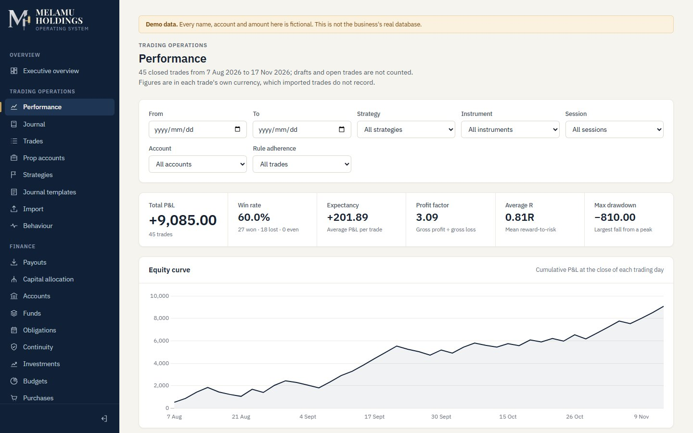

- **A trading journal:**
  - Trades recorded as drafts, open or closed, with versioned journal templates and a post-trade review.
  - A change history for every save.
  - Attachments checked by their content.
  - CSV import that never duplicates a trade or overwrites your notes.
- **Strategies with your own rules:**
  - A checklist on each trade.
  - Rule adherence shown with its denominator.
  - Results of trades that followed the rules compared with those that did not, never presented as cause and effect.
- **Performance and behaviour analytics:**
  - Win rate, expectancy, profit factor, equity curve and drawdown.
  - Breakdowns by strategy, session, day and journal answer.
  - Revenge-trading, overtrading and loss-streak alerts.
- **Prop firm accounts:**
  - Each firm's rules stored as data: drawdown model, daily loss, target, trading days.
  - Phases and history.
  - Where each account stands against its rules, and fees against payouts.
- **An optional AI-drafted review:** off unless configured. Journal text goes to the model as data, never as instructions. Facts, figures and the AI's interpretation are kept apart, and nothing is saved without the trader.

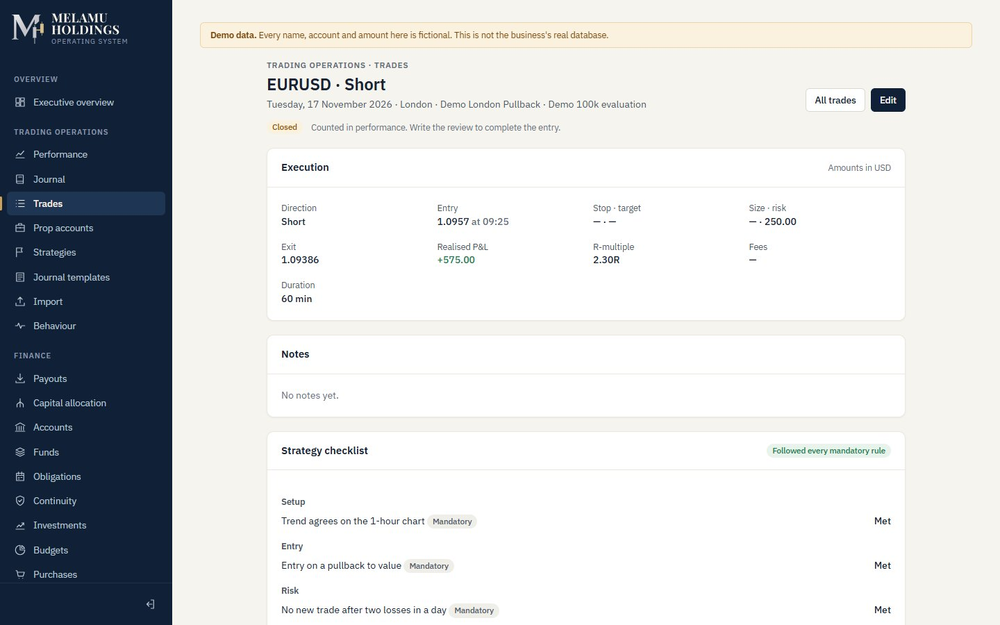

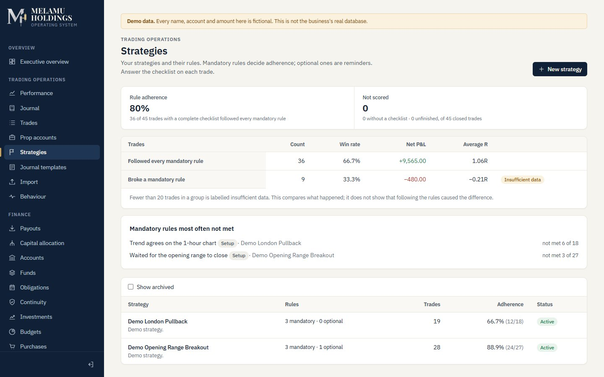

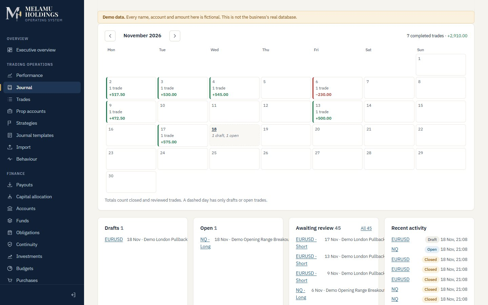

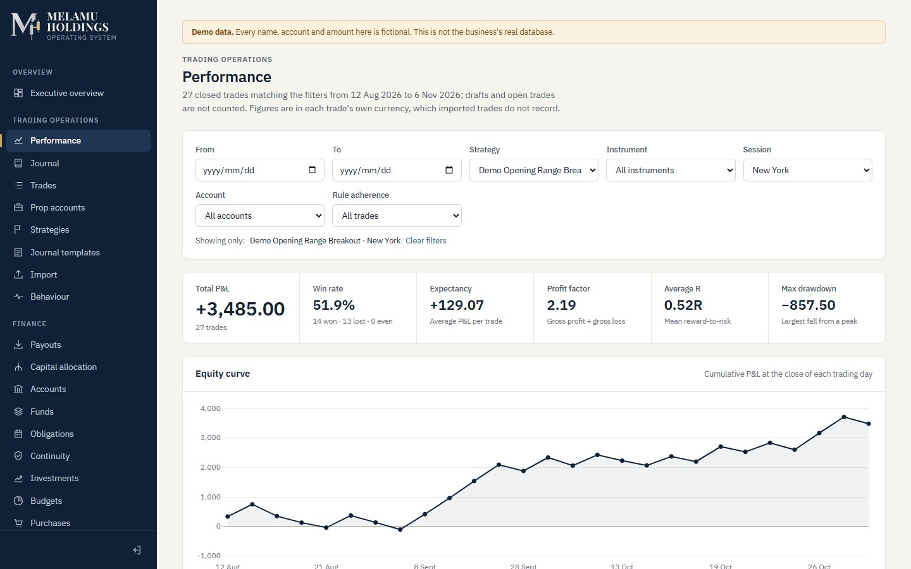

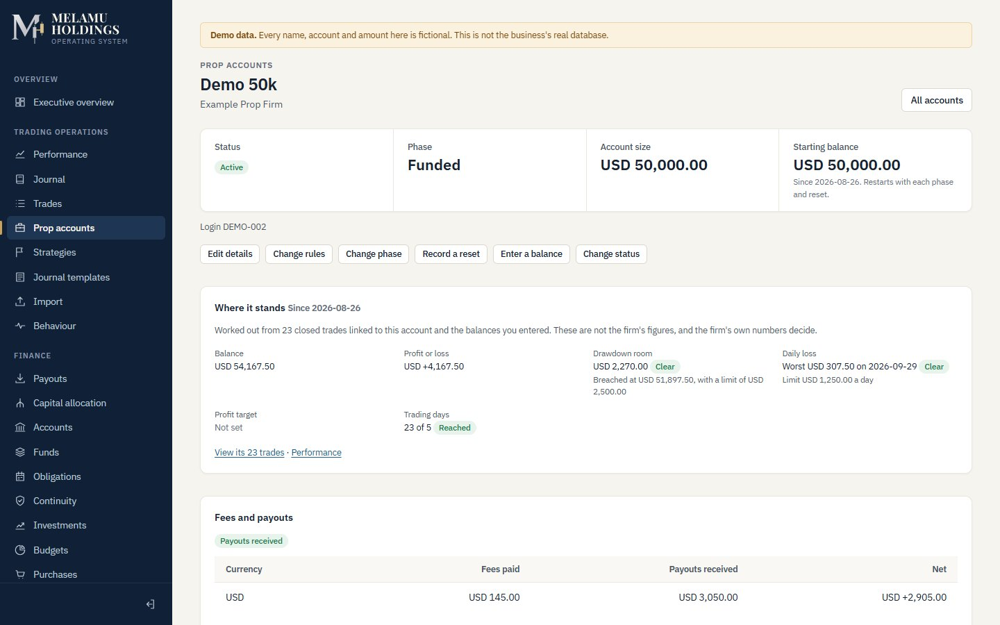

### Business planning

- **A goals ladder:** each goal is measured from the records (payouts received, funded accounts, fund balances, months of continuity) or ticked off by hand.
- **Payout what-ifs:** how an expected payout would split and what it would change. Nothing is saved, and it never counts as money.
- **Monthly cash flow,** and an **allocation history** of every payout and how each share was settled.
- **The company Handbook:** chapters written in the app, kept as drafts until approved as policy, with every change kept.

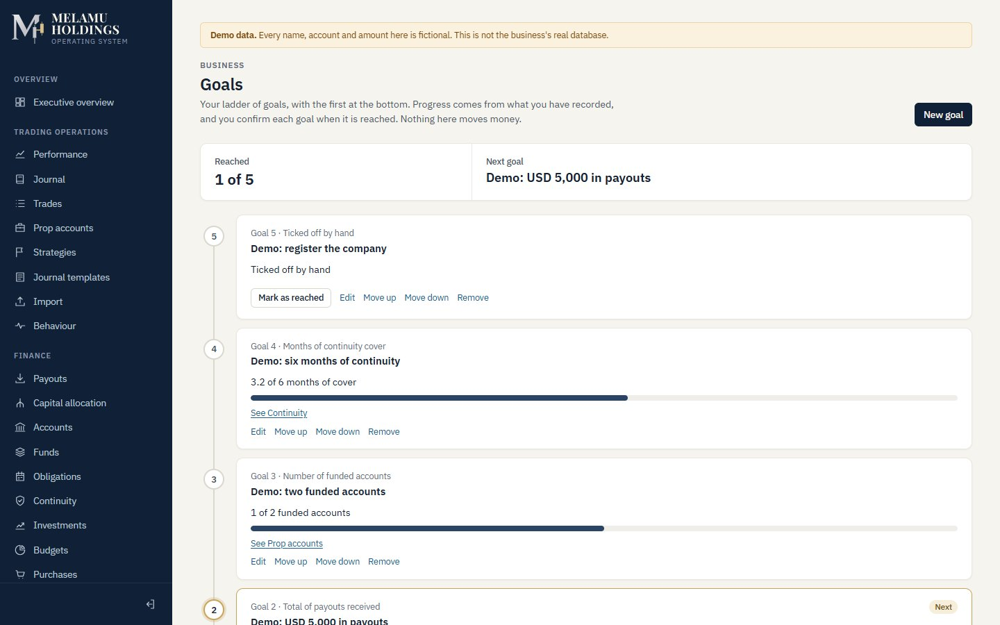

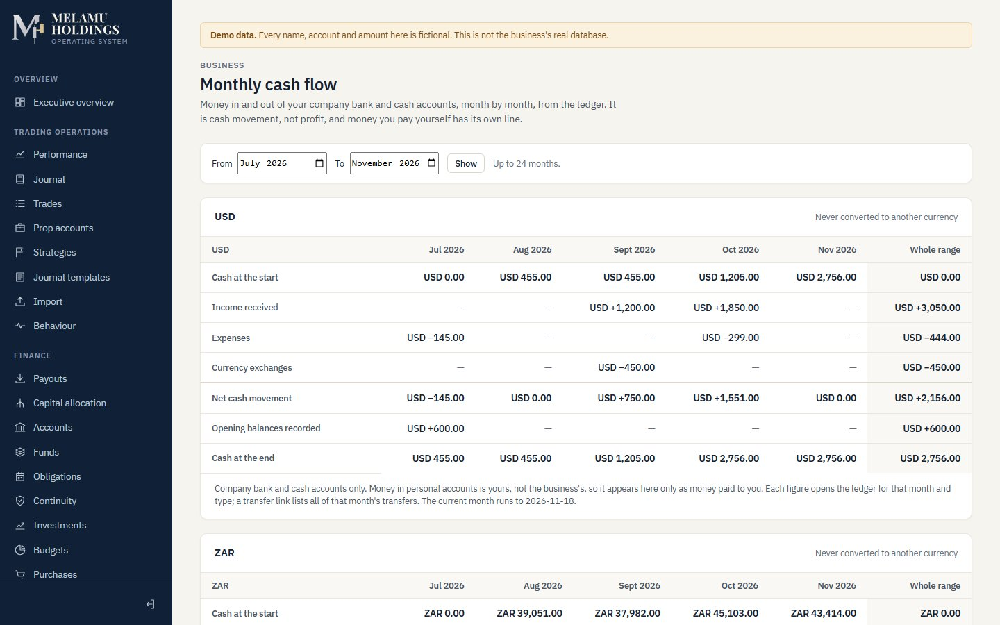

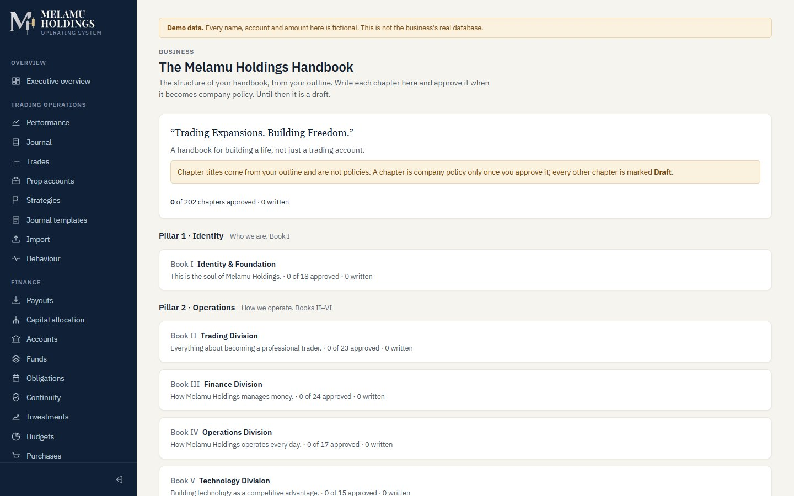

## How it is built

| Layer | Technology |
|---|---|
| Frontend | Angular 21: standalone components, signals, zoneless change detection; its own design system, with no UI framework |
| Backend | ASP.NET Core Web API on .NET 10, RFC 7807 problem details |
| Database | SQL Server with Entity Framework Core 10 migrations |
| Auth | JWT bearer tokens, BCrypt, login rate limiting, a single Owner role for finance |
| Tests | xUnit (unit, and API integration against a real SQL Server), Vitest (Angular), axe-core for accessibility |
| CI | GitHub Actions: Release build with warnings as errors, vulnerable-package gate, all test suites |

A clean, layered architecture (Domain → Application → Infrastructure → API) with the money rules in the domain layer. The overview is in [`docs/ARCHITECTURE.md`](docs/ARCHITECTURE.md).

### Engineering practices

- **Financial correctness first:**
  - Money is held in minor units with explicit currencies.
  - Every money movement goes through one posting path with idempotency, a database transaction and an audit event.
  - Unique indexes and row versions stop a payout being allocated twice, even under concurrent requests.
- **Tested (2026-11-19):** 412 unit, 183 API integration and 288 Angular tests, all passing, plus an automated accessibility check of every page.
- **End to end:** the payout-to-allocation workflow was also walked through by hand in the browser, with an amount that does not split into whole cents, and every balance checked against a hand calculation.
- **Controlled migrations:**
  - 24 EF Core migrations, replayed from empty and rolled down and up in a test.
  - The real database is backed up and the backup verified before each change.
  - The app refuses to start on an out-of-date database.
- **Security:**
  - Sign-in required by default, with a test over every endpoint.
  - Equal-time sign-in responses, and security headers on every response.
  - A strict Content Security Policy for the web app.
  - No secrets in the repository.
- **Accessibility:** every page checked with axe-core at desktop and phone widths and used by keyboard alone. There is a skip link, and focus moves to each new page's heading.
- **Honest data:**
  - No fabricated figures are presented as real.
  - The demo database is separate and labelled on every page.
  - A projected payout never counts as money.

## Status

The initial usable release is complete: all ten phases are verified against the original brief's Definition of Done. The system runs on the owner's own computer; **it is not deployed to a server**, and nothing here claims it is.

Known limitations, in short:
- Everything is entered by hand: no bank connections and no tax calculation.
- A trade has one entry and one exit.
- The optional AI review has only been tried against a stand-in server, not a real model.
- There are no automated browser end-to-end tests yet, and no screen reader has been tried.

## Code on request

The source code is private. If you would like to see it, for example for a hiring conversation, ask through my GitHub profile, [github.com/moeletsimelamu](https://github.com/moeletsimelamu).

## About me

Built by **Moeletsi Melamu**, a full-stack .NET developer working across software engineering, AI and fintech. My CV and experience are on LinkedIn: [linkedin.com/in/moeletsi-melamu-7b759642a](https://www.linkedin.com/in/moeletsi-melamu-7b759642a/).

My other public projects:
- [OpsHub](https://github.com/moeletsimelamu/opshub): an IT service desk.
- [DocuMind](https://github.com/moeletsimelamu/documind): a document assistant.
- [CloudOps Monitor](https://github.com/moeletsimelamu/cloudops-monitor): an operations platform.

## Licence

Copyright (c) 2026 Moeletsi Melamu. **All rights reserved.** Nothing in this repository may be used, copied or distributed without permission; see [`LICENSE`](LICENSE).
